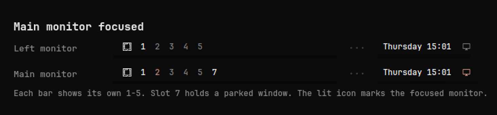
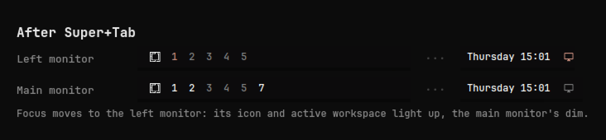

# Monitor Workspaces for Omarchy

Per-monitor workspaces for multi-monitor Omarchy setups. Every monitor gets its
own workspaces 1–9, 0, `Super + number` acts on the monitor you're on, and a
small icon in the middle of the bar tells you which monitor has focus.



## Why

With stock Hyprland, workspaces are global: `Super + 3` might be on either
screen, both bars show the same numbers, and it's easy to lose track of which
monitor you're about to send a window to. This plugin makes each monitor
self-contained:

- **Each monitor owns its own workspaces.** Monitors are ordered left to right
  by position, and each gets a block of ten real workspaces: the first monitor
  owns 1–10, the second 11–20, the third 21–30, and so on. Every bar shows its
  own block as **1–9, 0**.
- **`Super + 1…0` acts on the focused monitor.** Press `Super + 2` on your left
  monitor and you get the left monitor's 2; on the main monitor, the main
  monitor's 2.
- **`Super + Tab` jumps between monitors**, so you never need the mouse to
  change which monitor you're on.
- **Send a window to any workspace on the other monitor** in one chord:
  `Super + Ctrl + Shift + 3` puts it on the other monitor's 3. With three or
  more monitors, "other" is the next one to the right, wrapping around.
- **A focus badge** — a monitor icon next to the clock — lights up on the
  focused monitor's bar and dims on the others.
- **Slots 1–5 are always shown; 6–0 appear only while they exist**, so you can
  park a window on 6 without cluttering the bar.
- **Hotplug-aware.** Plugging in, unplugging, or rearranging monitors
  reassigns the blocks automatically. Nothing is tied to monitor names.



## Keys

| Keys | Action |
|---|---|
| `Super + 1…9, 0` | Switch to that workspace on the focused monitor |
| `Super + Shift + 1…9, 0` | Move the window to that workspace on the focused monitor |
| `Super + Shift + Alt + 1…9, 0` | Move the window there without following it |
| `Super + Ctrl + Shift + 1…9, 0` | Move the window to that workspace on the **other** monitor, and follow it |
| `Super + Tab` | Focus the next monitor |
| `Super + Shift + Tab` | Move the window to the next monitor |

These replace Omarchy's defaults for the same keys (global workspaces 1–10, and
next/previous workspace on `Super + Tab` / `Super + Shift + Tab`). Teardown
restores them.

Clicking a workspace number switches to it; clicking the badge focuses that
monitor.

## Install

```bash
omarchy plugin add https://github.com/vladgabrielboca/omarchy-monitor-workspaces.git --yes && ~/.config/omarchy/plugins/vladgabrielboca.monitor-workspaces/setup
```

`omarchy plugin add` fetches the plugin. `setup` then:

1. adds a small, clearly marked hook to the end of `~/.config/hypr/hyprland.lua`
   that loads the plugin's [`hypr/monitor-workspaces.lua`](hypr/monitor-workspaces.lua)
   (the keybindings and workspace rules), and reloads Hyprland;
2. puts the workspace numbers where `omarchy.workspaces` was (or right after
   the Omarchy menu) and the monitor badge just right of the clock.

Both files are backed up with a `.bak.<timestamp>` suffix first, and `setup` is
safe to run again.

Windows already open on workspaces that now belong to another monitor stay
where they are; move them with `Super + Shift + number`.

## Disable

Turn it off but keep it installed: this restores Omarchy's workspace keys and
widget exactly where they were.

```bash
~/.config/omarchy/plugins/vladgabrielboca.monitor-workspaces/teardown
```

Turn it back on with `setup`:

```bash
~/.config/omarchy/plugins/vladgabrielboca.monitor-workspaces/setup
```

> `omarchy plugin disable` only hides the bar widget and leaves the
> per-monitor keybindings active, so use `teardown` to switch it off fully.

## Remove

```bash
~/.config/omarchy/plugins/vladgabrielboca.monitor-workspaces/teardown && omarchy plugin remove vladgabrielboca.monitor-workspaces --yes
```

## Update

```bash
omarchy plugin update vladgabrielboca.monitor-workspaces --yes && hyprctl reload && omarchy restart shell
```

The keybindings update along with the plugin, since Hyprland loads them
straight from the plugin directory; `hyprctl reload` applies them, and
restarting the shell makes sure the widget's logic file is reloaded.

## Customising

- **Bar placement:** drag the widgets on the bar, or use `omarchy bar move`.
  Both are instances of `vladgabrielboca.monitor-workspaces`; the badge is the
  one with `"display": "Monitor badge"` in `~/.config/omarchy/shell.json`.
- **Block size:** `block` in `hypr/monitor-workspaces.lua` and `BLOCK` in
  `Model.js` must match (default 10, one per number key).

## Requirements

- Omarchy with shell plugin support and the Lua Hyprland config
  (`~/.config/hypr/hyprland.lua`; Hyprland 0.56+)
- `jq` (included with Omarchy)

## Tests

```bash
tests/model-test.sh   # monitor ordering, visible slots, labels (needs node)
tests/setup-test.sh   # setup/teardown round trip in a sandboxed config
```

## License

MIT
